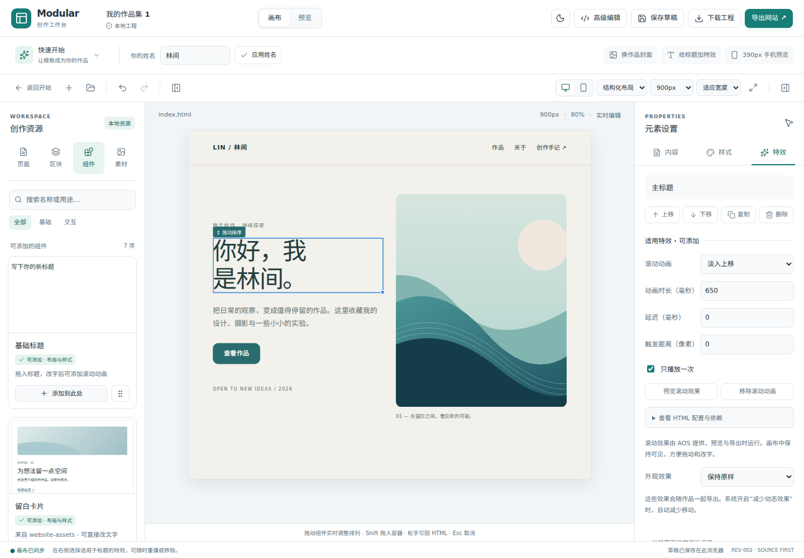

# Modular Website Studio

**面向新手的开源网站创作工作台：选模板、改内容、拖组件、加特效，导出自己的网站。**

[下载使用版](https://github.com/zczxz3/modular-website-studio/releases/tag/v0.1.0-alpha.2) · [第一次做网站](docs/guides/first-website.md) · [功能现状](docs/status.md) · [开发文档](docs/development/README.md) · [更新日志](CHANGELOG.md)



## 先选一种打开方式

| 你想做什么 | 下载什么 | 怎样启动 |
| --- | --- | --- |
| 直接使用工作台 | Release 中的 **modular-website-studio-web.zip** | 安装 Node.js 22.12+，完整解压；Windows 双击 `start.cmd`，macOS/Linux 运行 `sh start.sh` |
| 修改工作台源码 | Release 中的 **modular-website-studio-source.zip**，或克隆仓库 | 在项目目录执行 `npm ci`、`npm start` |
| 接着修改自己的作品 | 之前下载的 **website.mws.json** | 打开工作台，选择「打开项目文件」 |
| 把完成的网站交给别人 | 在工作台内点击「导出网站」得到的网站 ZIP | 解压后打开网站的 `index.html` |

使用版启动后打开终端显示的 `http://127.0.0.1:4173`。它是本地网页应用，需要 Node.js；当前没有 Windows 安装器或在线编辑地址。不要直接双击使用版的 `app/index.html`。

工作台面向桌面浏览器，建议宽度至少 1020px；390px 切换用于预览作品的手机效果。内容、图片和工程均在当前浏览器处理，无需账号、API 或后端服务。

## 十分钟完成第一个作品集

1. 首页点击「使用这个模板」，进入已经排好的中文作品集。
2. 换上自己的名字，点击标题、正文和按钮修改文字。
3. 点击作品封面，上传两张图片，按需要裁剪并填写图片说明。
4. 拖动整张作品卡片调整顺序，从左侧添加区块或组件。
5. 选中标题，在右侧「特效」添加淡入；切换到 390px 检查排版。
6. 点击「下载可编辑工程」备份，再点击「导出网站」交付完整作品。

[查看完整操作说明与常见问题 →](docs/guides/first-website.md)

## 当前能做什么

| 能力 | 已提供 | 具体说明 |
| --- | --- | --- |
| 模板起步 | 中文作品集、空白作品、源码示例 | [新手指南](docs/guides/first-website.md) |
| 图片与背景 | 上传、Cropper.js 裁剪、Grapick 渐变、本地批量素材 | [图片与渐变](docs/p0-visual-tools.md) |
| 组件与区块 | 内置 41 个目录项；支持整包导入和打开两页组件展架 | [资源接入与分类](docs/resource-sync.md) |
| 画布编辑 | 结构排序、自由移动/尺寸调整、Moveable + Selecto 多选变换 | [P1–P4 使用范围](docs/p1-p4.md) |
| 特效 | CSS 外观效果、AOS 滚动动画、AnimXYZ 组合预设 | [P1–P4 使用范围](docs/p1-p4.md) |
| 保存与导出 | 浏览器草稿、可编辑工程、完整网站 ZIP、受支持的单页 HTML | [保存与交付](docs/guides/first-website.md#保存和交付有什么区别) |
| 进阶编辑 | HTML/CSS 双向编辑、Monaco、事务撤销与重做 | [编辑契约](docs/development/editor-contract.md) |

**当前为 0.1.0 alpha。** 组件数量不代表独立实现数量，部分新手适配与原版重合。任意 JS/WebGL 插件、自动同步组件仓库、复杂动画时间轴、多人协作和桌面安装器仍未实现。[完整功能与限制 →](docs/status.md)

## 开发者启动

需要 Node.js 22.12+、npm 和 Git：

```bash
git clone https://github.com/zczxz3/modular-website-studio.git
cd modular-website-studio
npm ci
npm start
```

打开终端显示的地址。也可使用 **Code → Download ZIP**，完整解压后在含 `package.json` 的目录执行后两条命令。源码和依赖声明均为普通文件，无需初始化子模块。[下载故障排查 →](docs/checkout-and-release.md)

## 仓库怎样组织

| 目录 | 职责 | 阅读入口 |
| --- | --- | --- |
| `src/` | 编辑器界面、源码命令、隔离画布、模板与固定组件资源 | [源码地图](src/README.md) |
| `public/licenses/` | 工作台分发所需的第三方授权声明 | [开源复用记录](docs/open-source-reuse.md) |
| `examples/` | 可导入的静态网站与模块协议示例 | [示例说明](examples/README.md) |
| `docs/` | 使用指南、开发参考、当前状态和历史验收索引 | [文档总目录](docs/README.md) |
| `tests/`、`e2e/` | 单元/DOM 测试与真实浏览器回归 | [开发与验证](docs/development/README.md) |
| `scripts/`、`.github/workflows/` | 资源检查、启动、打包和自动构建 | [脚本说明](scripts/README.md) |

`website-assets` 负责组件研究与发行；本仓库负责创作、编辑、保存和导出。集成采用固定版本和稳定 ID，快速变化的远程同步与 JS 生命周期接口继续预留。[两仓库分工 →](docs/repository-overview.md)

## 许可与反馈

工作台采用 [MIT](LICENSE)。第三方组件、图标和动效保留各自的许可证与来源；随作品使用的资源会携带相应声明。问题反馈请附最小工程和复现步骤，见 [贡献指南](CONTRIBUTING.md) 与 [安全说明](SECURITY.md)。
