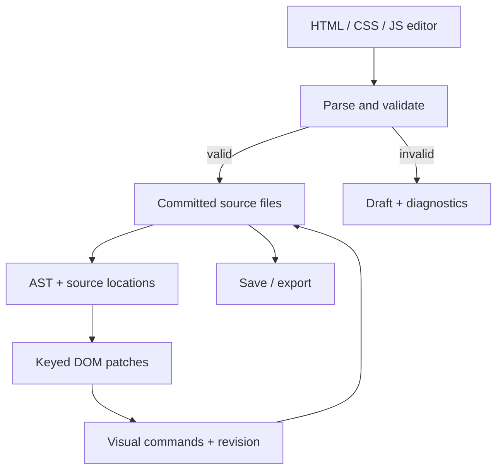

# Architecture decision — 2026-11-04

## Decision

Make source files authoritative. Parse HTML using parse5 source locations, apply small source patches through commands, and derive the editing canvas from the committed project. Keep invalid code as a draft in the same store until validation succeeds. Do not silently normalize the whole imported document through an HTML serializer.

## Evaluation

| Candidate | Strength | Fit for this project |
| --- | --- | --- |
| [Puck](https://puckeditor.com/docs) | React component registration, configurable fields, JSON-backed page building | Good future React adapter; source-preserving arbitrary HTML round trips still require a separate layer |
| [Craft.js](https://craft.js.org/docs/overview) | React editor building blocks, editable user components, drag/drop | Good custom component editor infrastructure; not the canonical raw HTML model needed here |
| [GrapesJS](https://grapesjs.com/docs/modules/Components.html) | HTML-oriented component management and import, established page-builder features | Closest general page-builder option, but importing into a component model does not itself preserve original source locations and formatting |
| [parse5](https://parse5.js.org/interfaces/parse5.ParserOptions.html) | HTML parsing with offsets and parse-error reporting | Selected for node/source mapping; inserted parser recovery nodes lack locations, so they are not treated as editable source nodes |
| [PostCSS](https://postcss.org/api/) | CSS AST, raw formatting and source information | Selected for validation and dedicated generated override rules; full cascade attribution is deferred |

This is a design inference from the documented data models, not a claim that those editors cannot be extended. The narrow MVP implements the source bridge directly so the core bidirectional contract can be tested first.

## Data flow

`ProjectStore` owns committed files, invalid drafts, diagnostics, revision, undo and redo. There is no independent authoritative canvas tree. `ElementInfo`, Monaco selection and iframe DOM are disposable projections. Commands carry the revision observed at pointer-down; stale operations are rejected. A multi-command transaction is calculated before committing, so a later failure does not partially apply earlier commands.

The initial import adds `data-mws-id` immediately after each explicit opening tag name. Otherwise it does not serialize or pretty-print the document. Text edits patch the inner range of leaf elements. Attribute edits patch one attribute span. Moves splice the original element substring. Deletions remove the node substring and generated descendant override rules.

Visual styles are explicit overrides in `studio.css`. The command creates a real link from every page to this stylesheet. Original CSS stays editable in its own file; inspector values and computed values are intentionally separate. This avoids pretending a computed value necessarily came from one directly editable declaration.

During dragging, the bridge temporarily moves the real DOM node or applies inline dimensions/translation for live feedback. It restores that temporary state before dispatching one revision-guarded transaction on release. Escape, pointer cancellation, leaving the viewport, blur or an incoming source update restores the original position and style without writing source. Pointer capture begins only after the movement threshold so click and double-click editing retain their targets. No-op structure drops create no history entry.

Duplication patches fresh stable identities and regular HTML IDs into the copied source slice, remaps internal HTML references, and clones generated override rules, including conditional rule context. It intentionally does not rewrite arbitrary imported CSS/JS selectors. Single-HTML export derives a separate output through source ranges and resource embedding; it never rewrites the canonical project to the exported form.

## Runtime and lifecycle

The editing iframe has `sandbox="allow-scripts"` without `allow-same-origin`. Only the bundled bridge is allowed by its nonce CSP. Source scripts, active attributes and embedded documents are omitted from the editable projection. Parent messages are checked against iframe `WindowProxy`, random channel and payload shape. Project code cannot call editor commands because it is absent from that iframe.

The bridge builds real nodes with `createElement` / `createTextNode`, reuses keyed elements, updates changed attributes and reorders children using DOM operations. It does not overwrite the page with `innerHTML`. Listeners on retained elements survive updates and cross-parent moves; this has a DOM test. The first iframe creation uses `srcdoc` for the trusted bridge shell only.

The explicit runtime preview is a separate sandboxed document and intentionally restarts when sources change. It has no command bridge and blocks network calls, forms, navigation privileges and parent access. Project JS state is not part of the visual editing model. Future JS/GSAP/Three adapters must own setup/dispose, event listeners, RAF loops, scroll ownership and GPU resource release.

The local tabs/accordion runtime is included as a project script with declarative source attributes. It owns per-instance listeners and restores runtime-added attributes on disposal. The editor displays all panels without executing the project runtime. Explicit preview permits classic data scripts so its own standalone HTML exports can be reimported and operated; the editing iframe remains nonce-only and excludes all project scripts.

## Performance bounds and next work

The MVP parses complete changed projects and keeps at most 100 immutable snapshots; this is a correctness baseline for small static sites. It is **not** an incremental parser. The DOM patch application is incremental. Next: debounced worker validation, semantic command history grouping, edit-distance mapping for deliberate ID removal, shared parsed indexes, CSS rule provenance and scoped module styles. Stable node IDs must survive saves, imports and future adapter conversions.
