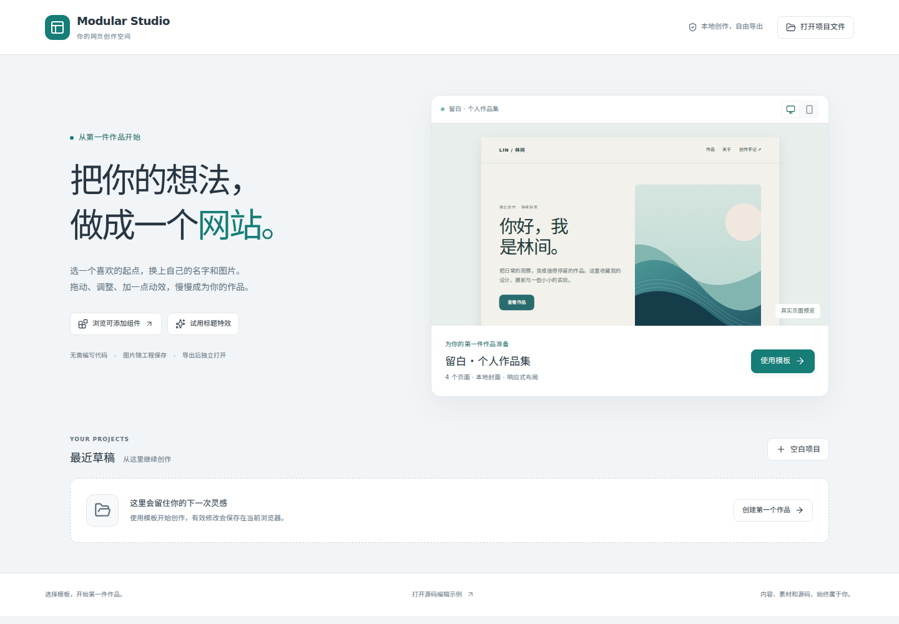

# 第一次做网站

[返回项目首页](../../README.md) · [文档目录](../README.md)

## 1. 打开工作台

在 [版本下载页](https://github.com/zczxz3/modular-website-studio/releases/tag/v0.1.0-alpha.1) 下载 `modular-website-studio-web.zip`，安装 Node.js 22.12+，把 ZIP 完整解压到一个普通文件夹。

- Windows：双击 `start.cmd`。
- macOS / Linux：在解压目录运行 `sh start.sh`。

保持终端窗口打开，在桌面浏览器访问显示的地址，通常是 `http://127.0.0.1:4173`。关闭终端会停止服务。网页包无需 npm 安装依赖；源码包则按 [源码启动步骤](../../README.md#开发者启动) 操作。

## 2. 选模板，改成自己的内容

首页选择「使用这个模板」。工作台的左侧选择页面和素材，中间显示作品，右侧修改当前选中内容。

先填自己的姓名，再点画布中的标题、正文或按钮，在右侧「内容」修改文字。正文支持多行输入，Ctrl/⌘ + Enter 应用，Esc 取消。需要修改结构和源码时再打开高级编辑。

## 3. 换封面，添加内容

点击封面，在右侧选择上传图片、使用已有素材或纯色。图片可裁剪，填写替代文字，并调整显示位置。同一个作品的首页和详情页封面会关联更新。

左侧「素材」支持批量图片导入；每批最多 30 张、20MB，单张不超过 10MB。选中画布图片后可使用素材，引用中的图片不能直接删除。

左侧「组件」选择「我的组件库 · 31」，按中文名称、用途或 ID 搜索，拖入画布或点击添加。左侧「区块」提供已配好布局的图文、行动区和数据区。表单只是前端控件，提交服务需要另行接入。

## 4. 调整排列和外观

| 你想修改什么 | 选择的操作 |
| --- | --- |
| 前后顺序、作品排序 | 结构化布局，拖动元素；需要移入其他容器时按住 Shift |
| 单个元素的位置和尺寸 | 自由布局，拖动或调整边缘尺寸；保留原布局空间 |
| 多个元素一起移动、旋转、对齐 | 多选变换，框选或 Shift 添加；最多 6 个元素 |
| 字体、颜色、间距、圆角、背景 | 选中元素，使用右侧「样式」；渐变背景可打开渐变编辑器 |

拖动中按 Esc 取消；完成一次拖动只产生一次撤销记录。复杂变换会提示范围限制，见 [P1–P4](../p1-p4.md)。

## 5. 加特效，检查手机效果

选中标题，在右侧「特效」选择淡入、触发时机、快慢与强弱；使用预览或重播查看。组合预设使用 AnimXYZ，滚动入场使用 AOS。原生悬停和 JS 交互应在显式「预览」或导出的网页里体验。

切换到 390px 检查标题换行、封面裁剪和按钮，再回到桌面尺寸。手机预览不等于手机可以完整操作编辑器。

## 保存和交付有什么区别

| 操作 | 文件或位置 | 应该怎样使用 |
| --- | --- | --- |
| 保存草稿 | 当前浏览器、当前地址的最近草稿 | 同一浏览器重新打开时继续；关注保存成功提示 |
| 下载可编辑工程 | `website.mws.json` | 自己保管；换电脑或明天打开工作台，用「打开项目文件」继续 |
| 导出网站 | 全站 ZIP | 发给别人或部署；保留所有页面、图片和已应用效果 |
| 导出 HTML | 受支持的当前单页 HTML | 适合独立单页；遇到跨页链接和不支持的依赖，改用全站 ZIP |

作品集是多页网站，请导出完整网站 ZIP，解压后打开 `index.html`。带模块脚本或浏览器受限功能的自建网站可能需要静态 HTTP 服务，导出不负责构建框架应用。保存草稿不能替代工程备份，网站 ZIP 也不保留完整的编辑器模块配置。

## 常见问题

**双击 HTML 打不开工作台？** 使用版包含模块与 Worker，需要启动 `start.cmd` / `start.sh`，通过 HTTP 访问。

**草稿不见了？** 检查是否换了浏览器、端口或地址；浏览器清理和容量限制会影响草稿。打开已下载的 `.mws.json` 恢复。

**网页上的脚本没有反应？** 编辑画布禁止执行作品脚本；切换「预览」或打开导出的网站。任意外部脚本和复杂框架没有完整适配。

**下载后只有空目录或 Git 报错？** 在新目录完整解压或重新克隆，按 [下载与恢复指南](../checkout-and-release.md) 检查，不复制旧工作树的 `.git` 指针。
