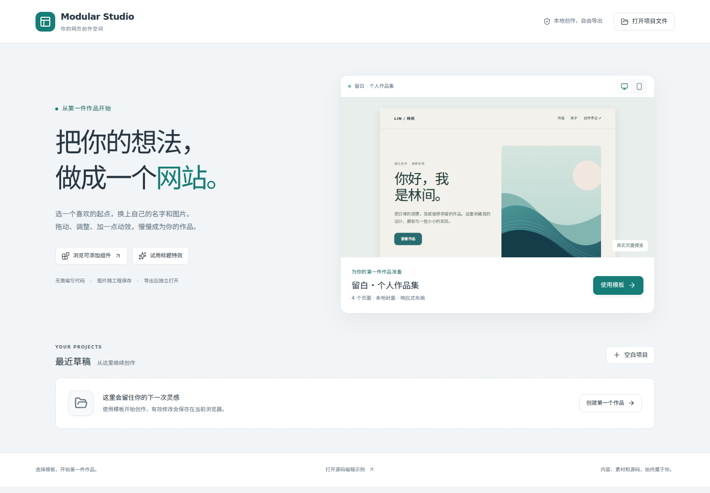
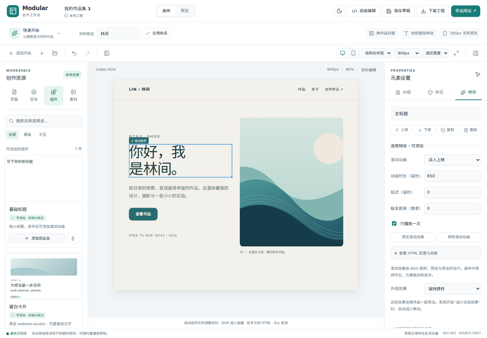
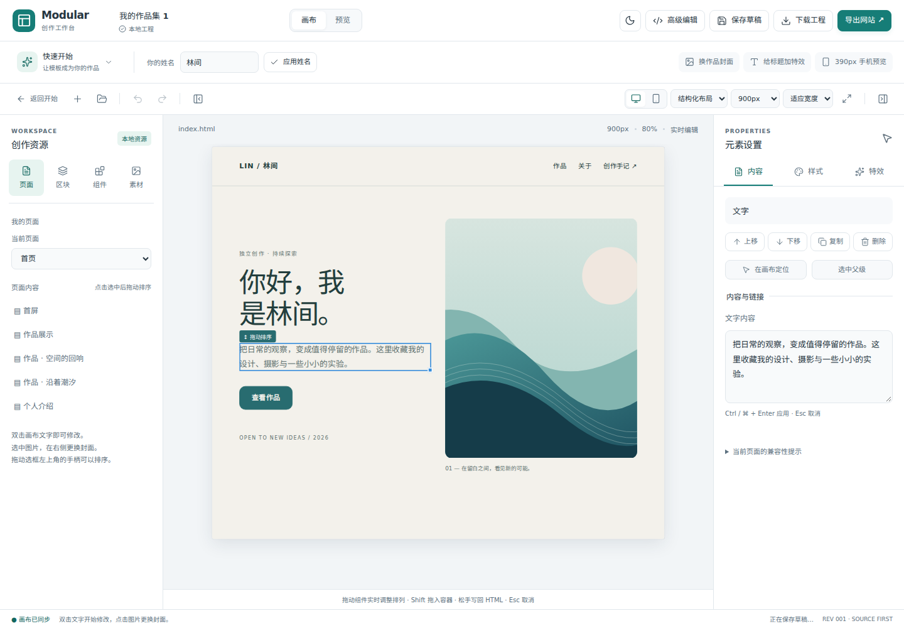

# 工作台界面打磨

> 阶段记录：以下测试数量、分支和范围属于记录时的版本。当前功能与发布状态见 [项目现状](status.md)，操作入口见 [新手指南](guides/first-website.md)。

本轮围绕「第一次打开即可开始创作」调整首页、资源面板、属性面板和画布。界面以浅色为默认，统一字体、间距、边框、按钮和状态提示，并提供深色外观。项目内容仍由原来的源码命令、撤销事务和导出器保存。

## 入口和操作层级

| 位置 | 当前行为 |
| --- | --- |
| 首页 | 直接展示真实作品集预览，桌面/手机可切换；使用模板、打开工程、最近草稿各有明确入口 |
| 顶部 | 工作区切换、保存草稿、下载工程和导出网站集中排列；源码编辑作为进阶入口 |
| 快速开始 | 姓名、换封面、标题特效、手机预览连在一起；可收起，为画布留出空间 |
| 左侧资源 | 页面、区块、组件、素材分组；组件支持搜索和基础/交互筛选，并显示真实可添加状态 |
| 右侧属性 | 分为「内容」「样式」「特效」；点选图片进入内容设置，已添加动画列表可直接定位到特效页签 |
| 画布 | 显示实际设备宽度和缩放比例，支持适应宽度、手动缩放，以及分别收起左右面板 |
| 外观 | 浅色/深色偏好保存在当前浏览器，界面切换不产生项目撤销记录 |

主要控件使用 12–13px 字号，保留键盘焦点和中文可访问名称；1024px 笔记本布局压缩辅助按钮，画布按可用空间缩放。编辑器面向桌面浏览器，手机尺寸用于作品预览。

## 参考与实际复用

| 参考 | 本轮落地 |
| --- | --- |
| VvvebJs / GrapesJS | 左资源、中画布、右属性的工作区结构；组件插入后在当前对象上继续编辑 |
| Mobirise / Pinegrow | 点击文字或图片后显示对应编辑项；封面上传和裁切放在选中图片的内容面板 |
| Shuffle | 资源以预览卡、用途说明、搜索和分类组织；当前仍是固定的本地资源集 |
| Silex / Webstudio | 模板从首页开始，最近草稿可继续打开；页面模板与组件资源分别呈现 |

具体阅读来源和已有 AOS 复用见 [开源复用记录](open-source-reuse.md)。本轮新增 `lucide-react` 1.68.0，复用一致的开源图标；完整 ISC 与衍生 Feather 图标 MIT 说明放在 [许可证](../public/licenses/lucide.txt)，随工作台构建分发。商业产品作为操作与信息组织参考。

`website-assets` 继续按稳定 ID 和版本预留接口；自动同步、远程安装及升级沿用 [资源接口](resource-sync.md) 的后续范围。

## 浏览器验收中修复的问题

- 浏览器无法把原生资源拖放直接送入不透明来源的 iframe。新增仅在拖入本地组件时启用的编辑器侧落点层，将坐标交给隔离画布命中检测；校验资源 ID 和版本后，仍通过原事务插入。
- 拖动作品卡经过手柄上方的空隙时，卡片可能被移出原网格。普通排序现在保持原父容器，跨容器仍用 Shift；两列网格正确按水平方向决定前后顺序。
- 文字按下时过早阻止默认事件，导致 Chromium 不发送双击事件。现在文字点击保留原生事件，实际拖动开始后才捕获指针；普通点击不重复插入 DOM，焦点进入画布也不会取消拖动。
- 模板图片规则曾压过用户设置的裁剪和圆角。图片默认规则现在使用较低优先级，选择「完整显示」立即生效，换内置封面和上传图片后仍然保留。
- 编辑投影曾把站内页面链接误转为二进制资源 URL。图片继续内嵌，导航链接保留原地址，导出和项目源码保持一致。

## 实际检查

2026-11-04 对本轮最终实现运行以下检查。此前文档中的浏览器启动限制属于对应历史版本；本轮已使用 Chromium 153.0.8010.0 执行真实交互和下载验收。

| 检查 | 实际结果 |
| --- | --- |
| `npm run check` | 通过：固定资源与 AOS 哈希校验、TypeScript、13 个测试文件的 94 项测试 |
| `npm run build` | 通过；Lucide 完整许可证随构建输出。已有 Monaco 大包提示仍存在 |
| `npm run test:e2e -- --workers=1` | 19/19 通过，用时约 1.3 分钟 |
| 新手完整流程 | 中文姓名、横/竖图上传、整卡排序、撤销重做、标题特效、390px 预览、草稿恢复、工程重开及 ZIP 断网打开通过 |
| 源码与交互 | 双击文字、代码往返、错误恢复、组件拖入、AOS 配置、JS 交互和独立 HTML 导出通过 |
| 界面 | 浅/深外观、搜索筛选、属性分组、面板收起、自动适配和主题偏好恢复通过；界面操作不产生项目撤销记录 |
| 视觉检查 | 首页 375/768/1024px 无页面横向溢出；桌面工作台 1024/1280/1440px 检查通过，含高级编辑和导出对话框 |

修复失败原因后运行全量用例，保留原验收并增强图片裁剪即时生效检查；没有用面板改字替代双击流程，也没有关闭 iframe 隔离来通过拖放测试。

可使用标准 Playwright 浏览器，也可指定现有 Chromium：

```bash
npm run check
npm run build
MWS_CHROMIUM_EXECUTABLE_PATH=/absolute/path/to/chromium npm run test:e2e -- --workers=1
```

`MWS_CHROMIUM_EXECUTABLE_PATH` 是可选项；不设置时继续使用 Playwright 默认浏览器。测试环境额外安装的浏览器和中文字体不成为产品运行依赖。

本轮仍属于 alpha 的界面与交互改进。五位首次使用者的独立体验尚待按 [可用性验收表](student-usability-check.md) 记录。

## 实际界面





[查看深色工作台](screenshots/interface-dark.png)

## 后续：内容编辑与元素定位

按最新顺序，先继续编辑器优化，再制作可安装平台。安装/PWA的中间准备单独保存在本地 `wip/platform-preparation`，不合入当前创作分支；该分支是未完成的检查点，不作为发布版。

本次改善：

- 正文、图片题注与引用文字使用可拉伸的多行输入框，长内容可以直接阅读和修改；Ctrl/⌘ + Enter 应用，Esc 取消，失焦也会应用。标题、链接和属性继续使用单行字段。
- 属性面板增加「在画布定位」与「选中父级」。左侧页面内容和已添加动画的点击属于显式导航，会滚动到目标；普通画布选择和拖动仍保持原来的滚动位置。
- 全局删除快捷键避开下拉框，防止在选择页面或设置参数时误删选中元素。

多行内容仍写入原 HTML 文本节点；换行的视觉表现遵循页面已有 CSS。编辑保留一次撤销和完整工程下载路径，定位与选择不产生项目修改记录。

验证：`npm run check` 94/94 通过；生产构建通过。新增浏览器用例验证取消/应用、撤销重做、下载工程保留中文正文，以及定位离屏元素、选择父级和下拉框 Delete 保护。界面定向测试 5/5 通过，最终完整浏览器回归 21/21 通过（约 1.3 分钟）。


