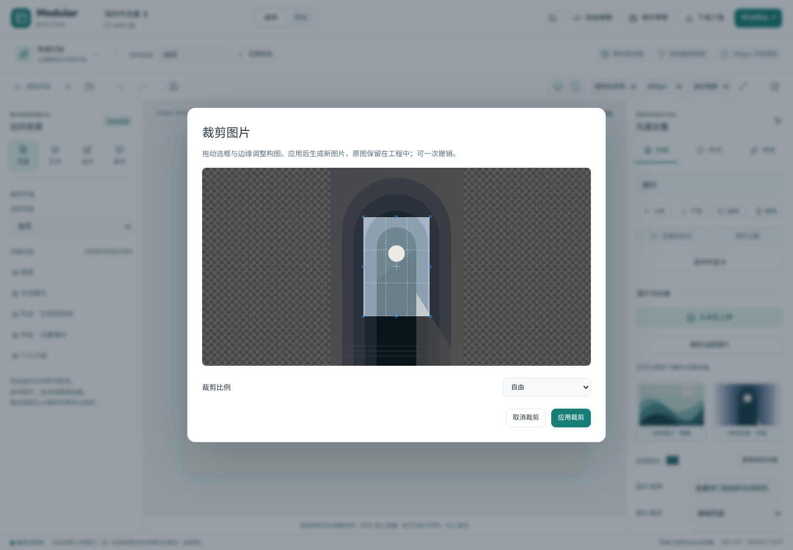
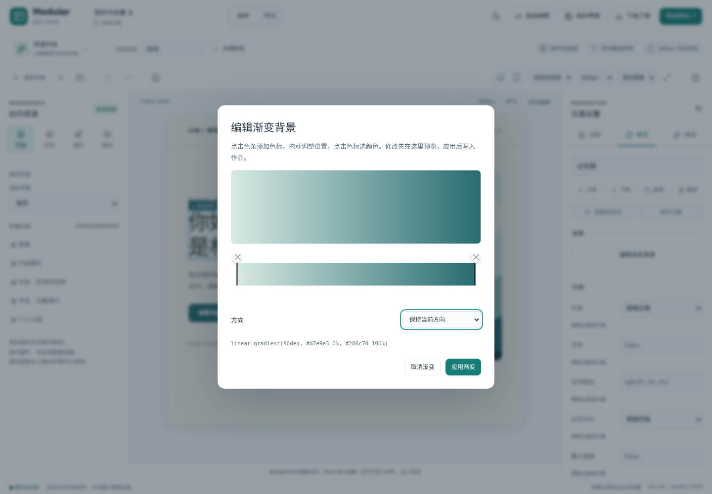

# P0：图片裁剪与渐变背景

本轮按独立功能库接入，保留现有源码、ProjectStore、撤销和导出内核。安装平台继续后置；其他画布库、区块库和动效库未作为本轮已集成功能列出。外部 website-assets 同步仍只保留接口。

## 已落地

| 工具 | 操作 | 持久结果 |
| --- | --- | --- |
| Cropper.js 2.3.1 | 选中本地图片 → 内容 → 裁剪当前图片；拖动选框和边缘，选择自由/方形/横竖比例，应用或取消 | 新的本地 PNG 素材、原图片稳定 ID、布局与替代文字；同一作品首页/详情封面一起更新 |
| Grapick 0.1.13 | 选中元素 → 样式 → 编辑渐变背景；添加/拖动色标、更换颜色和方向，应用或取消 | `studio.css` 中该元素的 `background-image`；移除覆盖可恢复页面默认背景 |

两个对话框在内部实时预览，点击应用才产生一次项目修改。取消不改变工程；撤销/重做、下载工程和网站导出继续沿用原流程。工具代码延迟加载，只用于编辑器；导出作品包含普通 PNG/CSS，不需要 Cropper/Grapick 运行库、CDN 或账号。

## 范围与边界

- 裁剪只处理已导入工程的本地图片，远程链接先下载/上传。输出长边最多 1600px，原图素材保留；超过四千万像素的输入会提示缩小。图片框尺寸、填充方式和裁切位置继续遵循已有页面设置，需要完整显示时选择「完整显示」。
- PNG 转换会生成新素材，不能把它声称为无损矢量裁剪。取消生成不会替换原图；工程版本变化时拒绝陈旧结果。
- 渐变首批支持 0–360 度线性渐变、2–16 个六位十六进制色标。复杂导入背景不交给库直接解释；界面提示从新渐变开始，取消仍保留原样。
- Grapick 内部会构造 HTML，因此传入它的已有 CSS 必须先通过数字/十六进制色标白名单，防止工程内容越过编辑隔离边界。
- 本轮没有并入另一套编辑器，也没有替换已有 AOS 动效或拖动引擎。Moveable/Selecto、精选区块、组合动效和批量素材管理仍是后续阶段。

## 来源与许可

- [Cropper.js 官方 API](https://fengyuanchen.github.io/cropperjs/api/)、[仓库](https://github.com/fengyuanchen/cropperjs)：MIT；固定 npm 2.3.1，主包及各 @cropper 依赖的原始许可证随工作台构建保留于 `public/licenses/cropperjs/`。
- [Grapick 官方仓库](https://github.com/artf/grapick)：发布包 README 与 package.json 声明 MIT，但没有独立 LICENSE 文件。本次完整保留这两份原始声明于 `public/licenses/grapick/`，不伪造上游版权文本。

## 验证

新增源码回归覆盖裁剪 PNG、跨页关联、替代文字、原图/样式保留、工程重开、ZIP 字节及撤销；渐变回归覆盖导入 CSS 的白名单边界。

浏览器定向用例实际拖动 Cropper 选框、取消和应用、检查正方形输出、撤销重做、保存工程并用新浏览器上下文重开；渐变用例检查初始预览、方向修改、取消/应用、一次撤销和独立 HTML 断网显示。

验证结果：`npm run check` 通过（15 个文件，97 项测试）；生产构建通过，保留既有 Monaco 大包提示；完整浏览器回归 23/23 通过。修正新色标颜色格式后，新增工具的 2 项定向浏览器用例再次通过。

