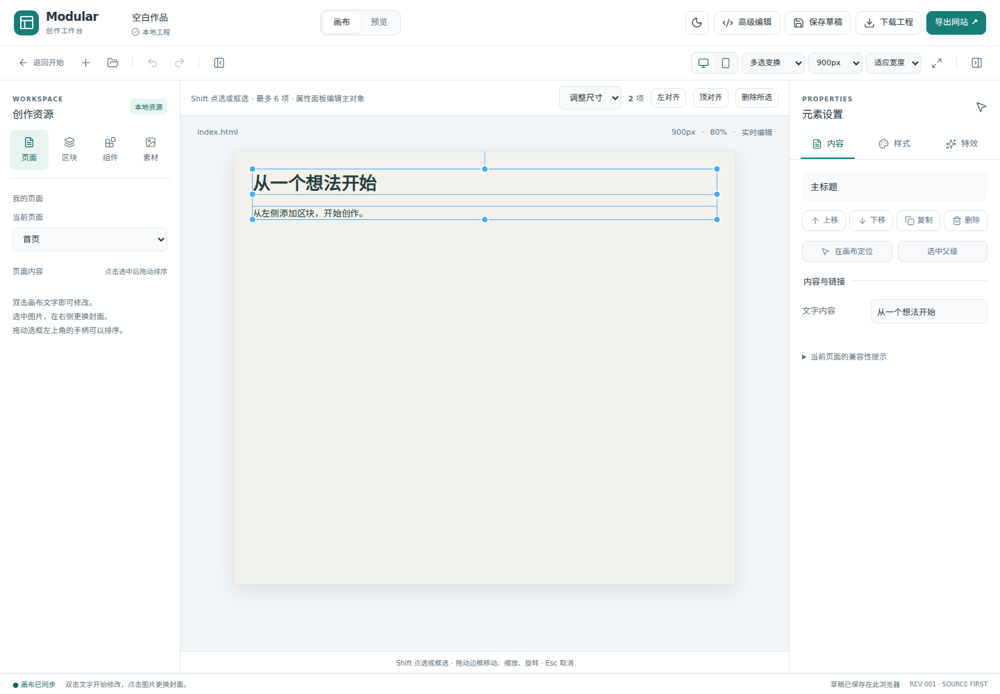

# P1–P4：首批可用集成

> 阶段记录：以下测试数量、分支和范围属于记录时的版本。当前功能与发布状态见 [项目现状](status.md)，操作入口见 [新手指南](guides/first-website.md)。

本轮继续已有 HTML/CSS 源码内核。安装平台和 website-assets 自动同步保持后置；新增功能全部通过已有项目命令或一次 ProjectStore 事务提交。

| 阶段 | 本轮交付 | 入口 |
| --- | --- | --- |
| P1 | 固定来源的 2 个精选区块：Tailblocks 联系行动区、HyperUI 成果数据区；加上原图文区块共 3 个区块 | 左侧「区块」；可搜索、拖入或点击添加 |
| P2 | Moveable 拖动、尺寸调整、等比缩放、旋转、元素吸附；Selecto 框选/Shift 添加选择；同父级左/顶对齐和批量删除 | 布局模式 →「多选变换」 |
| P3 | AnimXYZ 的 3 组组合预设、100–3000ms 时长与 0–3000ms 延迟、预览及移除 | 选中内容 →「特效」→「组合动效」 |
| P4 | 本地图片批量导入、去重、按文件名搜索、预览、复用、静态引用检查和删除 | 左侧「素材」 |

## P1：区块可用且可导出

上游原文件和许可证位于 `src/resources/curated/upstream/`，清单记录固定 Git 提交、源路径及 SHA-256。开发阶段通过 Tailwind CSS 4.3.4 编译，运行时只加载普通 HTML/CSS，不依赖 Tailwind CDN。

所有样式限制在 `.mws-curated` 容器内，Tailwind 内部变量加独立前缀；补充的盒模型重置也限制在该容器中。低优先级作用域允许右侧面板写入的局部样式正常覆盖。必要 SVG 显式闭合，适配编辑器的源码定位约束。

`node scripts/build-curated.mjs` 从固定原文件重建模块。生成结果按 Studio 原模块协议存储为 `modules.json`；许可证保留在模块 CSS 注释和工程 notices 中，单 HTML 与 ZIP 都可带走。示例邮箱、文字与数字需要用户换成自己的内容。当前选取明亮系列，不声称已接入上游全部区块或完整主题适配。

## P2：选择与变换

- 框选或 Shift 点选最多 6 个 HTML 元素；包含关系会去重，避免父子同时变换。
- 框的边缘/角点调整尺寸，可切换等比缩放；上方手柄旋转，选中元素可整体移动；Moveable 提供邻近元素吸附。
- 左对齐/顶对齐只在同父容器时启用。工具栏「删除所选」及画布 Delete 可一次删除全部选中元素，一次撤销恢复。
- 一个手势只提交一次事务；拖动中为临时 DOM 预览，松手写回样式，Esc 恢复并阻止迟到的手势提交。
- 编辑器主题、选框、Moveable/Selecto 脚本均不进入作品。保存的是普通 `translate`、`rotate`、`scale`、尺寸和 HTML 编辑命令。
- 右侧属性面板编辑主对象；多选边框和工具栏用于批量变换/删除。复杂变换父容器、百分比或三维起始变换会提示拒绝，避免错误坐标写回。自由移动保留原布局空间，不自动转换绝对定位。

结构排序、自由布局和多选变换相互独立，退出多选模式不会把旧选区覆盖到后续文字编辑。

## P3：组合动效

固定复用 `@animxyz/core` 0.6.7 的原始 CSS。适配层单独增加减少动态效果规则；原 CSS 与许可证由哈希检查保护。

HTML 保存 `xyz`、`data-mws-xyz` 和 `xyz-in`，`studio.css` 保存局部时长/延迟。组合动画当前在页面打开时播放；滚动触发继续使用已有 AOS。切换这两种入场方案会清理冲突配置，外观悬停效果仍独立存在。

编辑投影去掉临时播放类，保持文字和图片可见；预览/导出使用真实 AnimXYZ CSS。减少动态效果时停止动画。依赖按内容复用，路径冲突另存，不覆盖用户同名资源；移除某元素的组合效果不会删除其他元素共用的 CSS。

## P4：本地素材管理

每批最多 30 张、总计 20MB，单张不超过 10MB，读取前先检查大小。重复内容复用；文件名保留可搜索的原名片段。导入、替换和删除均可撤销，图片字节随完整工程与网站 ZIP 保存。

「使用图片」要求先选中画布图片，同一作品的关联封面继续同步。引用检查覆盖 HTML 地址、CSS url、模板模块和源码中的文件名字符串；可能的静态引用也阻止删除。无法推断任意 JavaScript 动态拼接的资源地址。删除未使用素材不删除下载文件，且可撤销。

这一阶段选择更完整的本地管理，不需要网络上传服务或 Uppy。浏览器草稿空间有限，大图片导入后应下载工程备份；存储不足继续沿用显式报错与旧草稿保留机制。

## 来源与许可

- Tailblocks：`mertJF/tailblocks`，`34943e63da6a2d45a55a076ea18312a1c1098957`，MIT。
- HyperUI：`markmead/hyperui`，`637323c8d3046645ac5f28edc2074d18f22a2b94`，MIT。
- Moveable 0.53.0、Selecto 1.26.3、AnimXYZ 0.6.7：固定 npm 版本和 lockfile，MIT。依赖原许可证/notice 与版本清单保存在 `public/licenses/dependencies/`；AnimXYZ 用于作品的许可证同时保存在工程文件和 HTML 注释中。

## 验证记录

源码回归覆盖模块编译与隔离、AnimXYZ 配置/冲突清理/工程重开、素材去重/引用保护/失败原子性。浏览器用例验证新增四阶段的操作、撤销、导出和断网打开，并保留此前完整编辑回归。

最终验证：`npm run check` 通过（16 个文件，100 项测试），含固定上游与 AnimXYZ 哈希检查；生产构建通过，保留既有 Monaco 大包提示。新增阶段的 4 项真实浏览器验收通过；全量 27 项浏览器回归通过。

