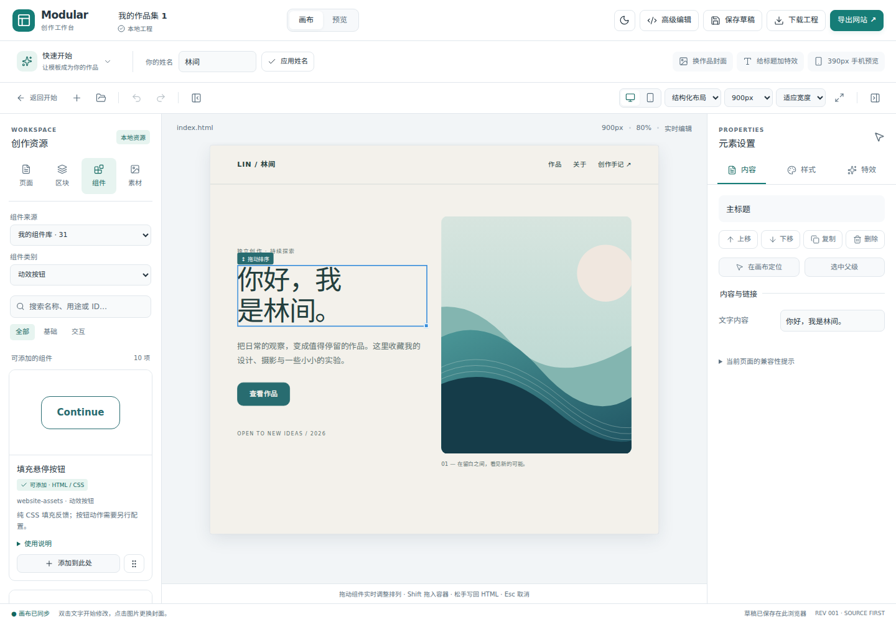

# website-assets 组件库接入

Studio 现在内置同账号仓库 `zczxz3/website-assets` 的 31 个兼容静态组件。它们直接出现在新手工作台，不需要逐个下载 ZIP 或进入高级编辑。

## 使用入口

进入模板或空白作品 → 左侧「组件」→「组件来源」选择「我的组件库 · 31」。可以按中文名称、英文原名、用途或稳定 ID 搜索，按类别筛选，然后拖入画布或点击「添加到此处」。卡片「使用说明」列出实际能力与限制。

| 类别 | 数量 | 示例 |
| --- | ---: | --- |
| 表单控件 | 7 | 单行、多行、选择、复选、开关、滑块、响应式表单组 |
| 展开内容 | 2 | 折叠内容组、行内帮助 |
| 导航链接 | 2 | 原生折叠导航、面包屑 |
| 内容卡片 | 3 | 图文、统计、价格方案 |
| 数据展示 | 1 | 基础表格 |
| 状态反馈 | 4 | 进度、旋转加载、骨架占位、常驻提示 |
| 布局容器 | 1 | 响应式双栏 |
| 动效按钮 | 10 | 填充、描边、波纹、柔形、扫光、光环、滚字、逐字、立体、回退 |
| 作品展示 | 1 | Queue 项目卡片 |

首次最多创建 12 张预览卡片，点击「显示更多组件」继续加载；搜索和分类覆盖完整目录。组件默认示例文字保留上游内容，可直接编辑。表单不连接服务器，加载/进度不连接请求，按钮不自动执行购买等业务动作。原生表单、details 和 CSS 悬停在「预览」或导出网页中体验；编辑画布优先用于选中与修改元素。

现有 10 个工作台模块继续保留，其中组件 7 个、区块 3 个。总目录因此为 41 项，其中 5 个新手适配示例与原版组件有实现重合；本轮不是重新实现 31 个组件。

## 固定版本与来源

| 项目 | 记录 |
| --- | --- |
| 来源仓库 | https://github.com/zczxz3/website-assets |
| 固定提交 | `cdaabdccfa9e4391e37450ef197e22e5f4eea83d` |
| 原始发行包 | `src/resources/website-assets-library/upstream/studio-components.zip` |
| Git blob | `a4e0022b0f62d3d46d28a748581bc6a111f40eaf` |
| SHA-256 | `e015138f31c82efd3313eb7ffecb61ef28f3b6e0d3c652f24d8ef3746ef1b562` |
| 原始目录与 manifest | 同目录的 `catalog.json`、`modules.json` |
| 本地接入与中文标签 | 同目录的 `index.ts` |

31 个模块继续使用上游稳定 ID，本地适配版本标为 `1.0.1`：把 `mf-` / `qr-` 类名以及三个具名动画加上 `wa-` 前缀，与以前的新手适配组件隔离，防止混用时覆盖样式；自定义属性继续使用原来的名称。上游 `foundation/pricing` 的金额文本 `mf-pricing0` 另修正为 `¥0`。中文名称、分类、用途与限制只属于面板展示信息；原始 HTML、CSS 和 manifest 保留在 `modules.json` 和原始发行包中。这不修改上游仓库，也不升级已有工程。

MIT 许可证保留在原始组件 CSS、来源目录和工程 notices 中，因此单 HTML 与网站 ZIP 都能带走相应声明。以前五个适配示例仍使用原来的冻结来源文件与哈希，属于历史示例集；不代表新组件库仍未接入。

## 既有接口与源码事务

`WEBSITE_ASSET_SNAPSHOT` 使用已有 `ModuleCatalogSnapshot` 协议，明确 provider ID、不可变 revision、静态 resources、files 与 notice。它加入本地 `RESOURCE_CATALOG`；`BUNDLED_RESOURCE_SOURCES` 标记静态库已内置。没有启动远程 provider、刷新计时器或网络更新。

添加仍走 `insertResource` → `validateModule` / `insertModule` → ProjectStore 单次事务：注册模块、写入局部 HTML、创建共享 CSS，并为每个使用页面写入正确的相对链接。一个操作可一次撤销。重复插入共享样式，已安装 manifest 与手工修改的 CSS 优先，重新打开项目后不会被新目录覆盖。

`node scripts/build-website-assets.mjs` 仅从本地原始发行包重建输出；`--check` 比较输出，不写文件。该脚本校验发行包 Git blob、SHA-256、31 个子 ZIP 校验和、静态 manifest 类别和重复 ID。`npm run check:resources` 包含该离线检查。

## 继续保留的接口

发行包中的运行时动效 tarball 和 E01–E20 待实现方案没有注册为可添加模块。编辑画布仍不运行工程脚本，普通模块仍拒绝脚本、内联事件、权限及外部依赖。

`ModuleCatalogProvider.loadSnapshot(revision, signal)` 继续保留，供后续显式导入/更新使用。任意 JS 动效需要独立的 mount/update/destroy、稳定目标绑定、预览/导出与资源释放契约；网络同步、自动升级和平台安装保持后置。

## 验证

新增源码回归逐个检查全部 31 个组件的验证、重复插入、跨页单 CSS 引用、撤销/重做、工程保存重开、网站 ZIP 与独立 HTML 导出；另检查目录边界与已有工程样式保护。

浏览器回归实际遍历 31 张组件卡并添加到画布，再验证中文分类/搜索、原生控件、390px 显示和断网 HTML；第二条流程检查重复插入、跨页复用、改中文文案、撤销、工程重开与断网 ZIP 解压站点。另验证原版与旧版主题卡片混用互不覆盖，原生拖入指示线和结构排序仍可使用。

最终验证（2026-11-04）：`npm run check` 通过（17 个文件、133 项测试）；`npm run build` 通过，保留既有 Monaco 大包提示；全量 Playwright 30 项通过，其中新增组件库浏览器流程 3 项。

